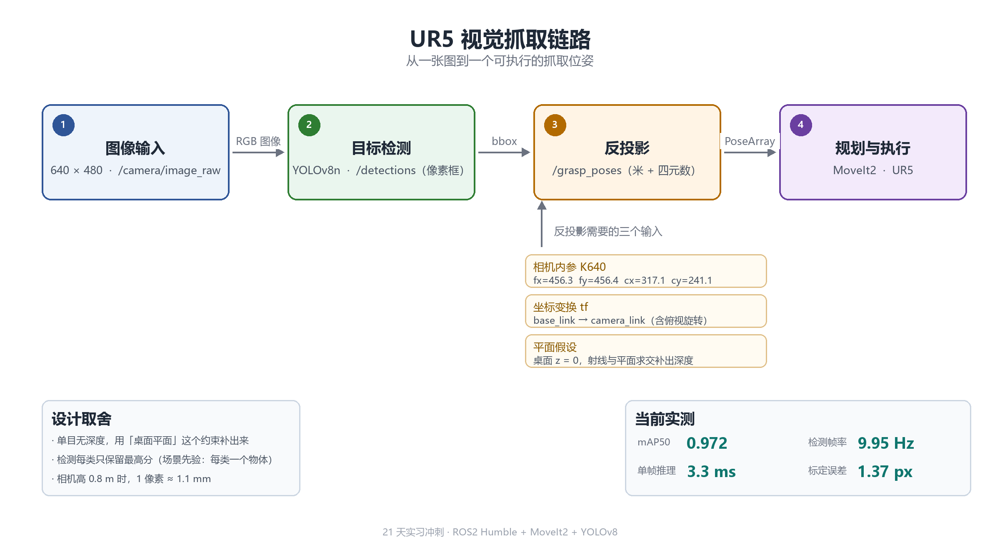

# UR5 视觉抓取 · 毕设前期技术栈记录

> 毕设题目是**面向电力设备操作的机械臂视觉引导**（UR5 + ROS2 + 视觉）。
> 这个仓库是入学前把相关技术栈摸熟的过程记录：一边查文档一边搭，跑通了写下来，卡住了也写下来。
> 以记录为主，代码保持可运行。

---

## 为什么从这儿开始

毕设要做的事情拆开看是三块：

1. 让机械臂动起来 —— ROS2 + MoveIt2
2. 让相机知道自己在桌面的哪个位置 —— 相机标定
3. 把画面上的像素变成三维坐标 —— 反投影

三块单独看都不难，但凑在一起坑很多（坐标系、四元数顺序、规划器报错）。
所以先用一个最小的抓取闭环，把整条链路走一遍，后面再往电力设备的具体操作上扩。

---

## 目前跑通的部分

| 环节 | 状态 | 关键数字 |
|---|---|---|
| ROS2 基础（话题 / 服务 / 参数 / launch / bag） | ✅ | — |
| tf2 坐标变换与四元数 | ✅ | — |
| 目标检测（YOLOv8n 训练 + ROS2 节点） | ✅ | mAP50 0.972 |
| 实例分割（YOLOv8n-seg，输出多边形） | ✅ | mask mAP50 0.95 |
| 相机标定（棋盘格） | ✅ | 重投影误差 1.37 px |
| 像素 → 三维（射线-平面求交） | ✅ | 1 px ≈ 1.1 mm @ 0.5 m |
| 抓取位姿（反投影 + 桌面空间最小外接矩形） | ✅ | 角度误差 < 1° |
| 规划执行（MoveIt2 + fake hardware） | ✅ | 8 次动作到位 4–10 mm |



**一次跑通的记录**（46 秒录屏，左侧是分割看到的东西，右侧是 MoveIt 驱动的 UR5e）：

[演示视频](https://github.com/yuan-yingxue/ur5-vision-grasp/releases/download/v0.1-demo/demo_day10.mp4)

> 说明：当前用 fake hardware，**没有物理引擎**，所以演示的是「位姿可达」而不是物理抓取。
> 真机部分要在实验室的 UR5 上再做一遍。

---

## 目录结构

```
ros2_ws/
├── src/turtle_ctrl/
│   ├── turtle_ctrl/          # 各节点
│   │   ├── circle.py              发布者练习
│   │   ├── pose_listener.py       订阅者练习
│   │   ├── param_circle.py        参数练习
│   │   ├── tf_demo.py             tf2 练习
│   │   ├── detector.py            检测节点（bbox）
│   │   ├── detector_seg.py        检测节点（多边形）
│   │   ├── grasp_pose_v3.py       反投影 + 位姿
│   │   ├── grasp_executor.py      发 MoveIt 目标
│   │   ├── image_cycler.py        循环发图（替代静态假相机）
│   │   ├── add_table.py           往规划场景加桌面碰撞体
│   │   └── det_view.py            检测结果可视化
│   ├── launch/               # launch 文件
│   └── setup.py
├── calib_test_640/           # 固定机位拍的标定/演示图（640 版）
├── docs/                     # 每天的记录与证据
└── README.md
```

---

## 怎么跑（fake hardware）

```bash
cd ~/ros2_ws
colcon build --symlink-install --packages-select turtle_ctrl
source install/setup.bash
```

```bash
# 1. 相机位姿（棋盘格解出来的）
ros2 run tf2_ros static_transform_publisher --x 0.6275 --y 0.0834 --z 0.8079 \
  --qx 0.993020 --qy 0.117085 --qz -0.013712 --qw 0.003723 \
  --frame-id base_link --child-frame-id camera_link
```

```bash
# 2. MoveIt + RViz
ros2 launch turtle_ctrl ur5e_moveit_small.launch.py

# 3. 桌面碰撞体
ros2 run turtle_ctrl add_table

# 4. 循环发图
ros2 run turtle_ctrl image_cycler --ros-args -p dir:=$HOME/ros2_ws/calib_test_640

# 5. 检测 → 位姿 → 执行
ros2 run turtle_ctrl detector_seg
ros2 run turtle_ctrl grasp_pose_v3
ros2 run turtle_ctrl grasp_executor
```

---

## 已知问题

这些是搭的过程中记下来的，还没解决或者暂时绕过去的：

- **fake hardware 没有物理** —— 只能验证位姿可达，抓取是否抓稳要上 Gazebo 或真机
- **相机高度靠棋盘格反解** —— 81.4 cm，但拍摄时棋盘格被挪过一次，两张照片解出的位置差了 12 cm
- **目标离基座太近会规划失败** —— 23 cm 时接近基座正下方的奇异区，把相机 tf 平移 30 cm 后才稳定
- **`INVALID_MOTION_PLAN` 只是重试兜底** —— 没根治时间参数化的问题
- **演示物体的尺寸接近夹爪极限** —— 计算器短边 8.5 cm，正好是 2F-85 的最大开度
- **背景误检** —— 场景里没有的杯子和耳机也会被检出（0.3–0.8），靠类别 + 置信度阈值过滤
- **反投影假设物体贴在桌面上** —— 有高度的物体（杯子）会把上半部分投到桌面外，尺寸偏大

---

## 记录

按天的记录在 `docs/` 里，包括训练曲线、标定参数、每天的终端输出和调试过程。
踩过的坑和当时的判断过程都留在 commit 里，方便以后回看。

---

## 参考

- ROS2 Humble 官方文档
- MoveIt2 教程
- Ultralytics YOLOv8 文档
- OpenCV 相机标定教程
